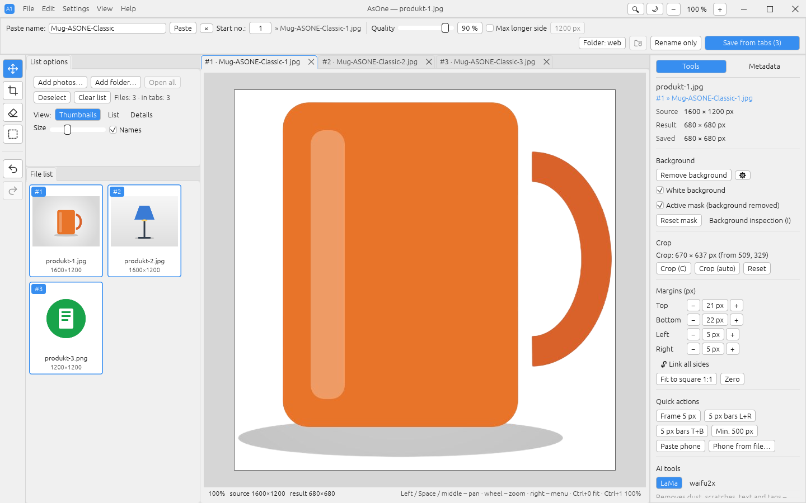
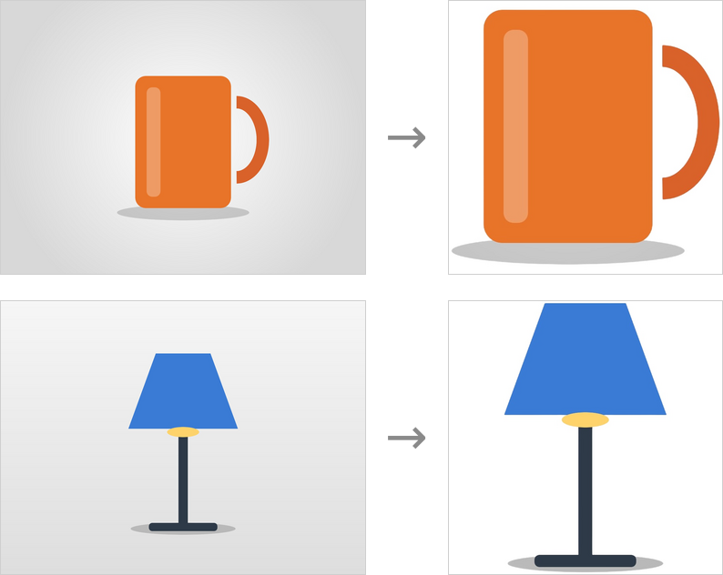

# AsOne – product photos for the web

[Polski](README.md) · **English**

A lightweight editor (Rust + `wgpu` + `egui_dock`) for one job: quickly prepare a batch of ~10
product photos for an online shop. Crop, margins, white background, square 1:1, background removal
(local AI model, eraser, rectangle), URL-friendly file names and export to metadata-free progressive
JPEG with size limits enforced on every save.

The interface is in English or Polish – it follows the system language (change it in Settings ›
Preferences › Interface › Język / Language). The theme follows the system's light or dark setting.

## Download

Latest version – pick your system:

| System | Download |
|---|---|
| **Windows** | [x86_64 (64-bit)](https://asone.lmk.one/pobierz/windows-x86_64/) · [ARM64](https://asone.lmk.one/pobierz/windows-arm64/) – unzip and run `asone.exe` |
| **macOS** | [Apple Silicon (M1 and later)](https://asone.lmk.one/pobierz/macos-arm64/) · [Intel](https://asone.lmk.one/pobierz/macos-x86_64/) |
| **Linux** | [AppImage x86_64](https://asone.lmk.one/pobierz/linux-x86_64/) · [AppImage ARM64](https://asone.lmk.one/pobierz/linux-aarch64/) · [Flatpak x86_64](https://asone.lmk.one/pobierz/flatpak-x86_64/) · [Flatpak ARM64](https://asone.lmk.one/pobierz/flatpak-aarch64/) |
| **Android** | [APK](https://asone.lmk.one/pobierz/android/) · [F-Droid repository](https://asone.lmk.one/) |
| **FreeBSD** | [x86_64 (tar.gz)](https://asone.lmk.one/pobierz/freebsd/) |
| **Browser** | [asone.lmk.one/app](https://asone.lmk.one/app/) – no installation |

All files and earlier versions: [Releases](https://github.com/LucasTerg/AsOne/releases).
<https://asone.lmk.one/> detects your system and offers the right file.

The Linux builds need glibc 2.35 or newer (Ubuntu 22.04, Debian 12, Linux Mint 21 and later). The
AppImage updates itself (Help › Check for updates) and carries update information for
AppImageUpdate / GearLever. Windows and macOS builds are not signed: on Windows choose “More info” ›
“Run anyway”, on macOS allow it in System Settings › Privacy & Security.



## Example

Left: the source photo; right: the file saved by AsOne – background removed (local RMBG model),
cropped to the product, square 1:1, 5 px frame, white background and a file name built from the
pasted product name (`Mug-ASONE-Classic-1.jpg`, `-2.jpg`, …).



## Features

- **File list and tabs** – drop photos or a whole folder (JPG, PNG, WebP, AVIF, TIFF, BMP); click a
  thumbnail to open it in its own tab `#1`, `#2`, …; drag to change the order.
- **Names** – paste a name following the Name-BRAND-Model pattern, e.g. `Mug ASONE Classic` →
  `Mug-ASONE-Classic-1.jpg`, `-2.jpg`, …; thumbnail menu › *Add version* → `…-2-ver2.jpg`.
- **Crop, margins, square 1:1, 5 px frame**, minimum side of 500 px (padded with white), export
  limits (default 3000 × 3600 px and 3 MB – quality drops first, then dimensions).
- **Background removal** – local BRIA RMBG-1.4 / 2.0 models (ONNX, nothing is uploaded) or
  RMBG-3.0 online via fal.ai (paid, commercial use); eraser and rectangle cut-out with undo / redo.
- **AI tools** – LaMa retouch (removes dust, scratches, text and tags, locally), waifu2x upscaling
  (locally) and prompt-based editing with FLUX Kontext on Replicate (paid, optional).
- **Phone overlay** – adds a 500 px white strip and pastes a phone photo you can move and scale.
- **Metadata panel** – where the file came from, copyright and license, AI markers, GPS; export
  strips all metadata.
- **Rename only**, ZIP and PDF export, recently opened folders on the start screen.
- **CLI and MCP server** (`asone-cli`) for automation – see the Polish README for options.

## Building

```sh
cargo run --release -p asone            # desktop app
cargo run --release -p asone -- *.jpg   # open files in tabs right away
cargo build --release -p asone-cli      # CLI + MCP
cargo test --workspace                  # tests (no GPU needed)
packaging/linux/package.sh              # AppImage + Flatpak in dist/
```

MozJPEG is a C library – a C compiler and `cmake` are needed (`--no-default-features` switches to
the pure-Rust `jpeg-encoder`). More details – platforms, Android, the web version – are in the
[Polish README](README.md#budowanie).

## License

MIT OR Apache-2.0 – see [LICENSE-MIT](LICENSE-MIT) and [LICENSE-APACHE](LICENSE-APACHE).
The optional AI models have their own licenses (BRIA RMBG-1.4 / 2.0: non-commercial; Big-LaMa:
Apache-2.0; waifu2x / nunif: MIT).
